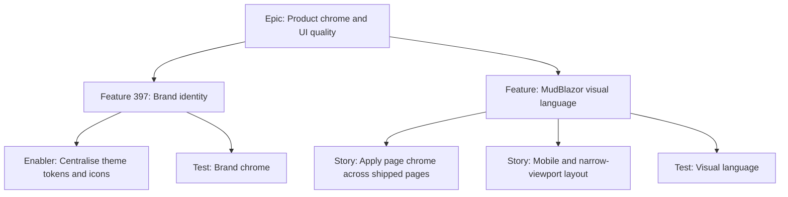

# Product chrome and UI quality — project plan

**Status:** Active pre–Spec Kit bundle (2026-11-15). **Visual language + narrow viewports** ship on milestone **`v1.4`** ([#527](https://github.com/markheydon/solo-dev-board/issues/527), [#528](https://github.com/markheydon/solo-dev-board/issues/528), [#530](https://github.com/markheydon/solo-dev-board/issues/530), [#411](https://github.com/markheydon/solo-dev-board/issues/411)). **Branding** ([#397](https://github.com/markheydon/solo-dev-board/issues/397), [#529](https://github.com/markheydon/solo-dev-board/issues/529), [#531](https://github.com/markheydon/solo-dev-board/issues/531)) is planned for milestone **`v1.5`** when un-parked. Index: [`product-chrome-ui-quality/README.md`](product-chrome-ui-quality/README.md). Cut-over: [`SPEC_KIT_MIGRATION.md`](SPEC_KIT_MIGRATION.md).

## Project overview

**Feature summary:** SoloDevBoard’s features work, but the Blazor UI still reads as a functional catalogue of papers and spinners. This plan splits **brand identity** (ice-box [#397](https://github.com/markheydon/solo-dev-board/issues/397)) from **visual language** (apply MudBlazor page chrome so the app feels like one product). Agent guidance is updated in the `mudblazor` skill so future delivery does not keep inventing raw layout. Responsive use in phone and compact-tablet browsers is a parked sibling story under the visual language feature ([#411](https://github.com/markheydon/solo-dev-board/issues/411)), not a third Feature.

**Success criteria:**

- Agents pick `MudToolBar`, `MudSkeleton`, `MudAlert`, `MudSplitPanel`, and `MudDateRangePicker` from the skill instead of ad-hoc papers and dual date fields.
- Shipped pages share header, toolbar, loading, empty, and error patterns (DEC-039).
- Narrow viewports (phone ~390 CSS px, compact tablet ~744 CSS px) keep the same chrome without overflow or a second navigation pattern.
- Branding (#397) remains parked until a logo decision; tokens from the styling audit are ready to apply when it is un-parked.

**Key milestones:** **`v1.4.0`** closes the visual-language stream; declare **`v1.5 - Product branding`** when `v1.4` is scoped closed and branding decisions are ready. Spec Kit becomes the default for new features after **`v1.5.0`**.

**Risks:** A full-page restyle can churn Playwright locators and docs screenshots. Mitigate by keeping `data-testid` values and treating screenshot recapture as part of the test issue.

## Review inputs

### Issue #397

Parked branding feature. Interim favicon is enough; proper identity is not a v1.3 gate.

### Human comments on #397

- Maintainer asked for a styling audit (custom CSS vs theme tokens vs duplicated icons).
- Maintainer posted the full inventory: four justified stylesheets; risk is duplicated tokens and chrome, not MudBlazor overrides.

### Bot comments on #397

- Cursor agent: custom CSS is small; branding risk is tokens and chrome in several places; no code changes in that pass.

### Pull request #398 (References #397)

Merged favicon swap. **No issue comments, no reviews, and no inline review threads** from humans or bots. CI checks on the head commit succeeded (build/test, both Playwright jobs, CodeQL, deploy list-steps). The PR body states it does **not** implement branding and leaves #397 ice-box.

### Issue #411

Originally a parked phone-width chore after Repositories overflow (#408). Recast as a mobile and narrow-viewport story under #527: compact tablet (iPad mini) is already usable; phone-width chrome and a documented viewport strategy remain. Native apps stay out of scope.

## Work item hierarchy

The first pass of the MudBlazor skill (UX-LANGUAGE.md and chooser updates) is done in this planning change-set so the UX story is not blocked on agent docs.

## Priority

| Item | Priority | Notes |
|------|----------|--------|
| Visual language story #528 | `priority/medium` | Milestone **`v1.4`**, `status/todo`. |
| Mobile layout #411 | `priority/medium` | Milestone **`v1.4`**, child of #527. |
| Test #530 | `priority/medium` | Milestone **`v1.4`**. |
| Branding #397 | `priority/low` | `status/ice-box` until **`v1.5`** is declared; then un-park. |
| Token / CSS enabler #529 | `priority/low` | Child of #397; deliver with **`v1.5`**. |
| Test #531 | `priority/low` | Child of #397; deliver with **`v1.5`**. |

## MudBlazor

Follow DEC-039 and `.agents/skills/mudblazor/references/UX-LANGUAGE.md`. Prefer `MudToolBar`, `MudSkeleton`, `MudAlert`, `MudCard`/`MudPaper` elevation 1. Do not add FABs, charts, or carousels.
